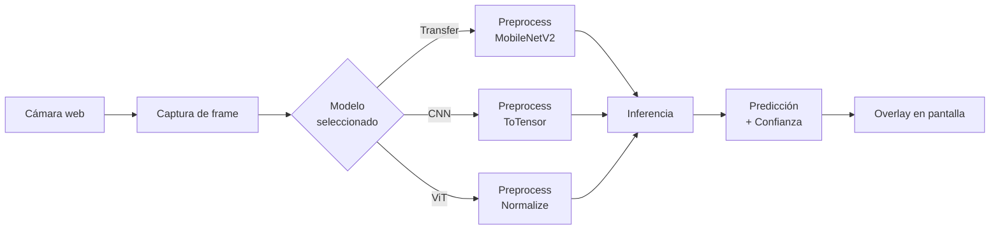

<div align="center">

# 🐾 Clasificador de Perros y Gatos

### Aplicación de escritorio con visión artificial en tiempo real

[](https://www.python.org/)
[](https://riverbankcomputing.com/software/pyqt/)
[](https://pytorch.org/)
[](https://keras.io/)
[](https://opencv.org/)

**Comparación de tres arquitecturas de deep learning para la clasificación binaria de imágenes**

[Características](#-características) · [Instalación](#-instalación) · [Uso](#-uso) · [Modelos](#-modelos) · [Estructura](#-estructura-del-proyecto) · [Resultados](#-resultados)

</div>

---

## 📋 Descripción

Este proyecto implementa una **aplicación de escritorio** capaz de clasificar imágenes de perros y gatos capturadas en **tiempo real desde una cámara web**. La aplicación integra tres modelos de aprendizaje profundo entrenados con enfoques distintos, permitiendo al usuario **cambiar entre ellos en vivo** y comparar su comportamiento.

El objetivo es demostrar la viabilidad de integrar modelos de visión artificial en aplicaciones funcionales, comparando el rendimiento de una **CNN desde cero**, un modelo de **Transfer Learning (MobileNetV2)** y un **Vision Transformer (ViT)** implementado desde cero.

---

## ✨ Características

<table>
<tr>
<td width="50%">

### 🎯 Funcionalidad principal
- Clasificación en tiempo real con cámara web
- Selector dinámico entre 3 modelos
- Visualización de confianza, tiempo de inferencia y FPS
- Captura de frames para análisis posterior
- Interfaz gráfica intuitiva con PyQt5

</td>
<td width="50%">

### ⚙️ Arquitectura técnica
- Procesamiento en hilo separado (QThread) para UI fluida
- Preprocesamiento dinámico según el modelo seleccionado
- Carga de modelos bajo demanda
- Compatibilidad con formatos `.pt`, `.keras` y `.pth`
- Verificación automatizada de pesos

</td>
</tr>
</table>

---

## 🚀 Instalación

### Requisitos previos

- **Python 3.10 o superior**
- **Cámara web** funcional
- **Sistema operativo:** Windows, Linux o macOS

### Paso 1: Clonar el repositorio

```bash
git clone https://github.com/tu-usuario/clasificador-perros-gatos-app.git
cd clasificador-perros-gatos-app
```
  
### Paso 2: Crear un entorno virtual (recomendado)

```bash
python -m venv venv

# Windows
venv\Scripts\activate

# Linux/macOS
source venv/bin/activate
```

### Paso 3: Instalar PyTorch (CPU)

> ⚠️ **Importante:** Instala PyTorch primero con el comando oficial para CPU. Esto evita conflictos con otras dependencias.

```bash
pip install torch torchvision --index-url https://download.pytorch.org/whl/cpu
```

### Paso 4: Instalar las demás dependencias

```bash
pip install -r requirements.txt
```

### Paso 5: Colocar los modelos entrenados

Asegúrate de que los archivos de los modelos estén en la carpeta `models/`:

```
models/
├── cnn-best_model.pt
├── tl-modelo_perros_gatos.keras
└── vit_dogs_cats.pth
```

---

## 🎮 Uso

### Ejecutar la aplicación

```bash
python main.py
```

### Flujo de uso

1. La aplicación **carga automáticamente el modelo CNN** al iniciar.
2. Presiona **▶ Iniciar cámara** para activar la cámara web.
3. Muestra un objeto (perro o gato) frente a la cámara.
4. Observa la predicción en tiempo real con su nivel de confianza.
5. Usa el **selector de modelo** para cambiar entre CNN, Transfer Learning o ViT.
6. Presiona **📸 Capturar frame** para guardar una imagen del análisis actual.

### Verificar los modelos sin abrir la cámara

```bash
python verificar_modelos.py
```

Este script comprueba que los tres modelos cargan correctamente y ejecutan una inferencia de prueba.

Para clasificar una imagen específica:

```bash
python verificar_modelos.py --imagen ruta/a/tu/imagen.jpg
```

---

## 🧠 Modelos

<table>
<thead>
<tr>
<th align="left">Modelo</th>
<th align="center">Accuracy</th>
<th align="center">Parámetros</th>
<th align="center">Tamaño</th>
<th align="center">Enfoque</th>
</tr>
</thead>
<tbody>
<tr>
<td><strong>Transfer Learning</strong><br><sub>MobileNetV2 (ImageNet)</sub></td>
<td align="center"><strong>98.61%</strong></td>
<td align="center">2.60 M</td>
<td align="center">13.13 MB</td>
<td align="center">Preentrenado</td>
</tr>
<tr>
<td><strong>CNN desde cero</strong><br><sub>4 bloques convolucionales</sub></td>
<td align="center">91.01%</td>
<td align="center"><strong>0.42 M</strong></td>
<td align="center"><strong>1.70 MB</strong></td>
<td align="center">Desde cero</td>
</tr>
<tr>
<td><strong>Vision Transformer</strong><br><sub>ViT pequeño (6 bloques)</sub></td>
<td align="center">72.93%</td>
<td align="center">2.86 M</td>
<td align="center">10.92 MB</td>
<td align="center">Desde cero</td>
</tr>
</tbody>
</table>

> 💡 **Nota:** El modelo **Transfer Learning** se establece como predeterminado por su mayor precisión. La **CNN desde cero** destaca por su compacidad, siendo ideal para entornos con recursos limitados.

---

## 📁 Estructura del proyecto

```
clasificador-perros-gatos-app/
│
├── main.py                  # Interfaz gráfica (PyQt5)
├── inference_worker.py      # Hilo de captura e inferencia
├── cnn_model.py             # Arquitectura y carga de la CNN
├── vit_model.py             # Arquitectura y carga del ViT
├── verificar_modelos.py     # Script de verificación
├── requirements.txt         # Dependencias del proyecto
│
└── models/                  # Modelos entrenados
    ├── cnn-best_model.pt
    ├── tl-modelo_perros_gatos.keras
    └── vit_dogs_cats.pth
```

---

## 🔄 Flujo de la aplicación



---

## 📊 Resultados

<div align="center">

| Métrica | Transfer Learning | CNN | ViT |
|:---|:---:|:---:|:---:|
| **Accuracy** | 98.61% | 91.01% | 72.93% |
| **Precisión (macro)** | 98.62% | 91.37% | 73.04% |
| **Recall (macro)** | 98.61% | 91.01% | 72.93% |
| **F1-score (macro)** | 98.61% | 90.99% | 72.90% |
| **Tiempo de entrenamiento** | 34.5 min | 21.7 min | 34.1 min |

</div>

### Conclusiones principales

- 🏆 **Transfer Learning** logró la mayor precisión gracias al preentrenamiento en ImageNet.
- ⚡ **CNN desde cero** ofreció un excelente equilibrio entre rendimiento y eficiencia (solo 422 K parámetros).
- 🧪 **ViT desde cero** demuestra la viabilidad de implementar transformers sin preentrenamiento, aunque requiere más datos para igualar a las CNN.

---

## 🛠️ Tecnologías utilizadas

<div align="center">

| Categoría | Tecnología |
|:---|:---|
| **Lenguaje** | Python 3.10+ |
| **Deep Learning** | PyTorch, Keras (backend PyTorch) |
| **Visión por computadora** | OpenCV, Torchvision, Pillow |
| **Interfaz gráfica** | PyQt5 |
| **Procesamiento numérico** | NumPy |
| **Visualización** | Matplotlib, pandas |

</div>

---

## ⚠️ Solución de problemas

<details>
<summary><strong>Error: WinError 1114 al importar PyTorch</strong></summary>

Este error suele ocurrir por conflictos entre versiones de PyTorch y el entorno. Solución:

```bash
pip uninstall torch torchvision torchaudio -y
pip install torch==2.8.0 torchvision==0.23.0 torchaudio==2.8.0 --index-url https://download.pytorch.org/whl/cpu
```
</details>

<details>
<summary><strong>Error: Keras backend ya inicializado</strong></summary>

La aplicación debe iniciarse desde cero. Si cambias el backend de Keras en tiempo de ejecución, cierra el proceso y vuelve a ejecutar `python main.py`.
</details>

<details>
<summary><strong>La cámara no se abre</strong></summary>

- Verifica que no esté siendo usada por otra aplicación (Zoom, Teams, etc.).
- Prueba con otro índice de cámara modificando `cv2.VideoCapture(0)` a `cv2.VideoCapture(1)` en `inference_worker.py`.
</details>

<details>
<summary><strong>Modelo no encontrado</strong></summary>

Asegúrate de que los archivos estén en `models/` o en la raíz del proyecto. El script busca en varias ubicaciones por defecto.
</details>

---

## 📚 Referencias

- Cukierski, W. (2013). *Dogs vs. Cats* [Dataset]. Kaggle.
- Sandler, M., et al. (2018). MobileNetV2: Inverted Residuals and Linear Bottlenecks. *CVPR*.
- Dosovitskiy, A., et al. (2021). An Image is Worth 16x16 Words: Transformers for Image Recognition at Scale. *ICLR*.
- Paszke, A., et al. (2019). PyTorch: An Imperative Style, High-Performance Deep Learning Library. *NeurIPS*.

---

<div align="center">

⭐ Si este proyecto te resultó útil, considera darle una estrella ⭐

</div>
```

